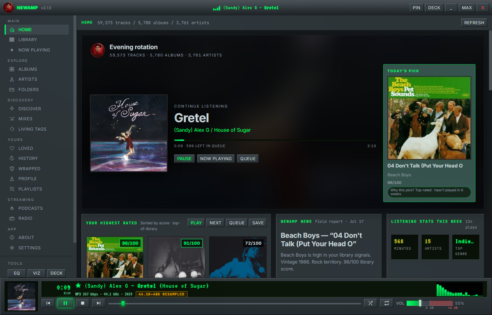
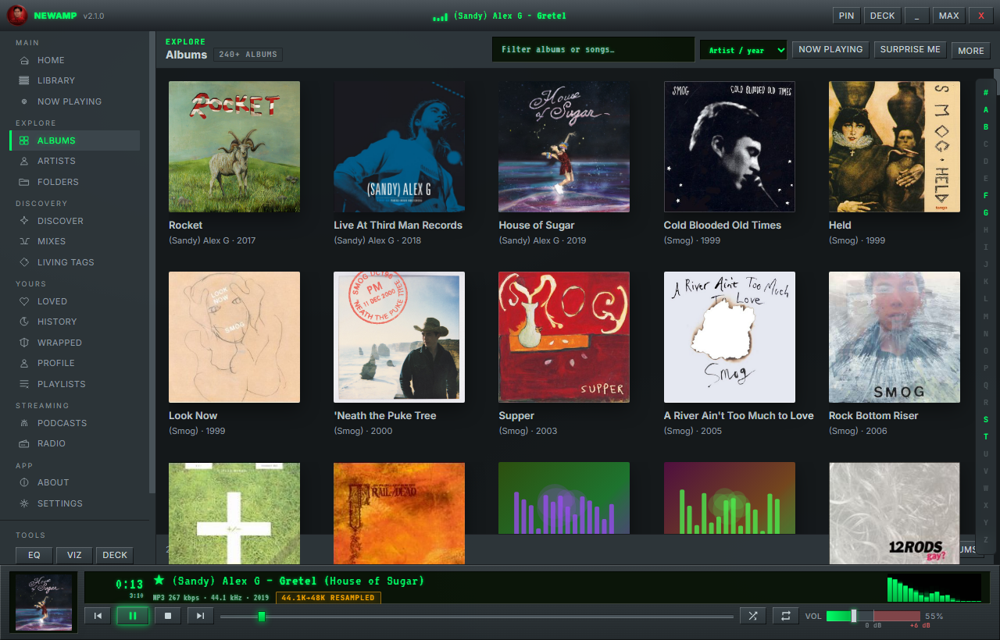
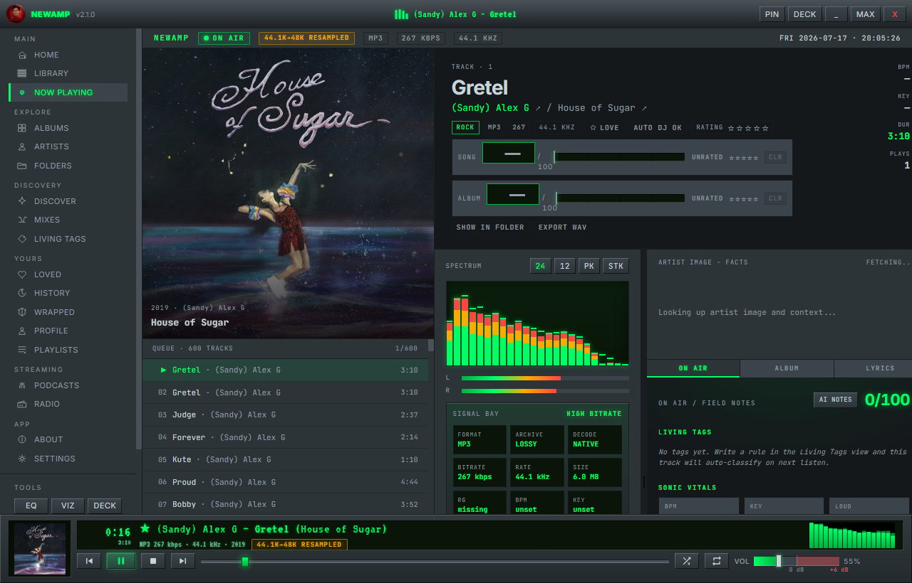
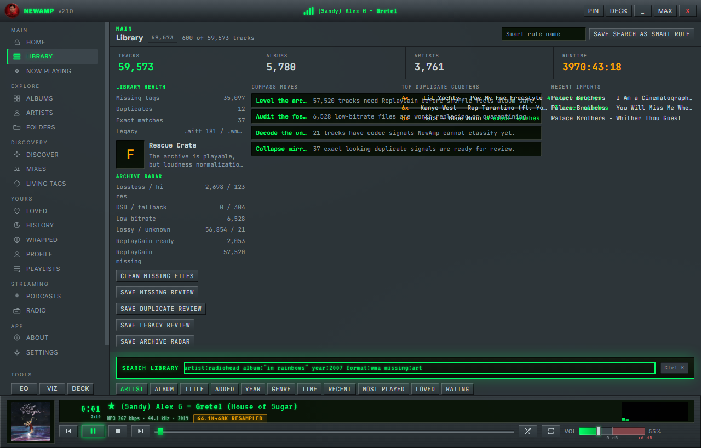
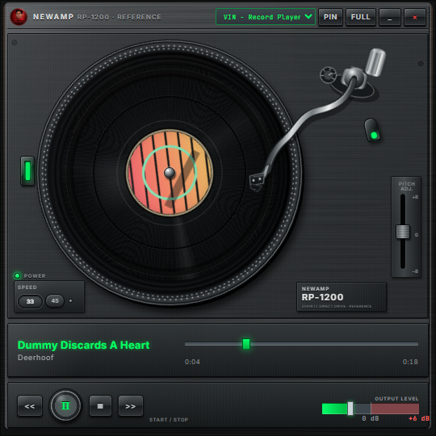
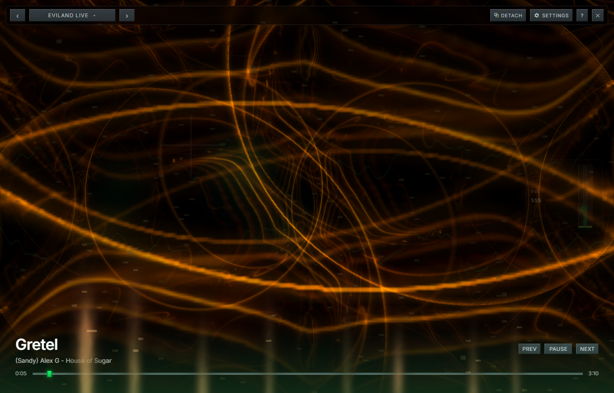

<div align="center">


# NewAmp

**A music player for files you already own.**

Windows, macOS, and Linux. Free and open source.

[](https://github.com/evilander/newamp/releases/latest)
[](LICENSE)

</div>

---

## What it is

Point NewAmp at a folder of music and it plays it. It keeps a library and your
play history on your machine. There is no account and no NewAmp server. Two
lookups run on their own while Now Playing or Artists is open: lyrics from
lrclib.net, and artist and album summaries from Wikipedia. Everything else that
touches the network is something you turn on or press. The [Privacy](#privacy)
section lists every request.

I built it because I still keep music on a hard drive and wanted a player that
treats that as normal.

## Download

Get it from the [latest release](https://github.com/evilander/newamp/releases/latest).
Replace `<version>` with the release number:

| Platform | File |
| --- | --- |
| Windows | `NewAmp.Setup.<version>.exe`, or `NewAmp.Portable.<version>.exe` if you'd rather not install |
| macOS | `NewAmp.<version>.arm64.dmg` (Apple Silicon) or `NewAmp.<version>.x64.dmg` (Intel); `.zip` builds of both are attached too |
| Linux | `NewAmp.Linux.<version>.x64.tar.gz`: extract and run `./newamp` |

The portable build keeps its library in a `NewAmp Data` folder next to the exe,
but only when no profile exists in the default location. If you've run a
portable build before, it keeps using `%APPDATA%\newamp`, and so does a portable
exe in a read-only folder.

The builds aren't signed with a Windows or Apple developer certificate. Windows
SmartScreen will want "More info" then "Run anyway". On macOS:

1. Open the app once and dismiss the "Apple could not verify" dialog.
2. Open System Settings, go to Privacy & Security and scroll down to the
   Security section.
3. Click Open Anyway next to the message about NewAmp. The button only appears
   for about an hour after the failed launch. Enter your password if asked, then
   confirm the dialog that follows.

If macOS says "NewAmp is damaged and can't be opened" instead (builds up to
2.3.0), clear the quarantine flag and open it again:

```sh
xattr -cr /Applications/NewAmp.app
```

Checksums for every file are in `SHA256SUMS.txt`.

The Linux tarball needs the shared libraries every Electron app needs. A desktop
install has them. On a minimal Debian or Ubuntu image, install them with
`sudo apt install libnss3 libasound2 libgtk-3-0` (on Ubuntu 24.04 and Debian 13
the last two are `libasound2t64` and `libgtk-3-0t64`). If it exits with a
sandbox error, run `./newamp --no-sandbox`, or from the extracted folder run
`sudo chown root:root chrome-sandbox && sudo chmod 4755 chrome-sandbox`.

## What it does

- Plays MP3, FLAC, OGG, Opus, WAV, M4A (AAC or Apple Lossless), AAC, WMA, AIFF,
  APE, WavPack, DSD (DSF and DFF), Musepack, TTA, Matroska audio, AC-3 and DTS.
  [docs/features.md](docs/features.md#formats) says which ones need the bundled
  ffmpeg.
- Track lists draw only the rows on screen, so large libraries scroll without
  rendering every row. [Large libraries](#large-libraries) has the limits.
- The seek bar draws the playing track's waveform for local files, and the
  mouse wheel over it seeks 5 seconds per notch. Settings → Performance turns
  the waveform off.
- Winamp-style keyboard control: space, arrows, `L` to love, `0`-`5` to rate,
  `Q` to queue the focused row, `F` for fullscreen visuals, `Ctrl+K` for Quick
  Play, `Ctrl+F` to search the library and `Ctrl+M` for deck mode. On macOS use
  Cmd in place of Ctrl, except deck mode, which is Cmd+Shift+M because Cmd+M is
  Minimize.
- Visualizers: MilkDrop presets through Butterchurn, plus Eviland, my own
  engine that reacts to separate frequency bands instead of one lumped envelope.
  For local files Eviland also analyzes the track ahead of time (up to the first
  20 minutes) to find bar lines, builds and drops, and uses that to time look
  changes. Detection is a best guess, and a track is analyzed the first time an
  Eviland mode shows it.
- Skins, including imported Winamp 2.x `.wsz` files, and compact "deck" modes
  that shrink the window into something resembling a physical device. A colour
  editor floats over the app, the fullscreen visualizer included, so you can
  tune a skin while it plays. The sidebar's groups collapse, and its items hide
  and reorder.
- Smart playlists, an Auto DJ, and ratings. Library search takes field filters
  (`artist:radiohead year:2007 format:wma missing:art`) and ignores case and
  accents. Living Tags are rules such as
  `tag(deep_cuts) when playcount = 0 and rating >= 3 and not loved`.
- Synced lyrics, podcasts, internet radio, CUE sheets, and Last.fm scrobbling.
  Scrobbling needs your own Last.fm API key and shared secret (create them at
  last.fm/api/account/create, then enter them in Settings → Last.fm).
- Jellyfin and Navidrome / compatible Subsonic servers: connect, browse, search,
  and play through the queue and visualizers.
- Listening-history import from Last.fm or CSV/JSON exports, with duplicate
  detection and a report of tracks that could not be matched.
- Wrapped: listening stats for today, the week, the month, the year or all time,
  built from your own play history. It exports a PNG card or a 30-second video.
- A phone remote over your own Wi-Fi, via a QR code. It is off until you turn it
  on.
- Move to Recycle Bin / Trash from the track right-click menu. It asks first.

[docs/features.md](docs/features.md) is the full reference, including the
keyboard shortcuts.

## A look at it

| Home | Albums |
| --- | --- |
|  |  |

| Now Playing | Library |
| --- | --- |
|  |  |

| Record player deck | Eviland visualizer |
| --- | --- |
|  |  |

More in `assets/screenshots/`.

## First run

1. Open it. It'll offer to scan your Music folder, or you can drop any folder on
   the window.
2. Scan time depends on your disk, file formats, artwork, and library size.
   Subsequent scans skip unchanged files, and a scan can be cancelled.
3. `Ctrl+K` opens Quick Play (search, commands, and plain-English requests),
   `Ctrl+F` searches the library, `F` goes fullscreen, and `Ctrl+M` (Cmd+Shift+M
   on macOS) shrinks the window to a deck.
4. Settings → Shell and Settings → Skin change how it looks.

Music Servers in the sidebar connects to Jellyfin and Navidrome. Include any
reverse-proxy subpath in the server URL. Connections can last for this session
or be saved with the OS credential store. Music streams from the server;
server tracks are not copied into the local library or saved playlists.

History → Import listening history accepts a Last.fm username (using your API
key from Settings → Last.fm) or a CSV/JSON file. Scan your local music first so
plays can be matched. Imported plays feed Mixes, History, and listening stats.
The [feature reference](docs/features.md#listening-history-import) documents
file columns and matching behavior.

## Large libraries

`npm run bench:library-scale` builds a 350,000-track synthetic database and
reports import, search, paging and reopen times, memory use, and how long the
main thread was blocked. The rows are generated metadata, so it does not measure
audio-file parsing, artwork reads, or responsiveness with a real collection of
that size. The library is an in-memory SQLite database, so memory grows with the
number of tracks, and a search that matches many rows can block the main process
while it runs.

## Size, memory, and Electron

NewAmp is an Electron app, so it is large. On 2.5.1 the Windows installer is
115.1 MB and the unpacked install is 393.7 MB (375.5 MiB, the figure Explorer
shows). Of that, 298.1 MB is the Electron runtime (Chromium and Node), 82.8 MB is
the bundled ffmpeg that handles decoding and transcoding, and 12.8 MB is the rest
of the `resources` folder, mostly NewAmp's own code and assets. MB here are
10^6 bytes. After `npm run package`, the figures come from
`ls -l "release/NewAmp Setup 2.5.1.exe"`, `du -sb release/win-unpacked`,
`du -sb release/win-unpacked/resources` and
`ls -l release/win-unpacked/resources/app.asar.unpacked/node_modules/ffmpeg-static/ffmpeg.exe`.
A native player is a fraction of that size.

Memory use is higher than a native player's too. How much depends on the size of
the library and on whether a visualizer is open, which adds the most. Task
Manager lists the main process and several helper processes; add them up for the
total.

The 2.1.0 installer was 136 MB. 2.2.0 cut it to 115 MB by removing duplicate
copies of libraries already bundled into the app, 54 Chromium locale files the
app never uses, and a DirectX shader compiler that only WebGPU needs. The size
has not changed much since.

If you want a small, low-memory native player, NewAmp is not it, and foobar2000
or Winamp itself will suit you better. Electron let one person build and ship
this on three platforms, and the visualizers are WebGL, which suits the browser
engine. That is the tradeoff.

## Privacy

- No telemetry, no analytics, no update check. Crash dumps are written to the
  profile folder and are never uploaded. Check the releases page for new
  versions. The install contains an `app-update.yml` that the packaging tool
  writes; NewAmp never reads it.
- Every network request belongs to a feature, and the table below is the
  complete list.
- The lyrics and Wikipedia lookups have no off switch. To avoid them, stay out of
  Now Playing and the Artists view, or block lrclib.net and en.wikipedia.org in
  your firewall; nothing else depends on those hosts.
- The phone remote and Radio Brain (your library as an HTTP radio station) are
  off by default. When on, they listen on all network interfaces (port 17117
  unless you change it) over plain HTTP, with no encryption. Every route except
  the remote page itself, which holds no data, needs a token unique to your
  install, and the token appears in the playlist and audio URLs. Turn them on
  only on a network you trust.
- Your music files are never written to. Scanning and playback open them
  read-only. The one change NewAmp makes to a music file on disk is Move to
  Recycle Bin / Trash in the track right-click menu, which asks first, backs up
  the library, and moves the file to the system bin. Ratings, play counts, tags
  (including Living Tags), lyrics, metadata and album art rescues, and bookmarks
  are rows in the library database, not edits to the files, so seeding,
  checksums, and backups are unaffected. Exports (WAV, MP3, FLAC and Opus
  conversion, playlist folders) create new files in a folder you choose.
- Music server passwords use the OS credential store when Remember connection is
  on. The Last.fm API key, shared secret and session key, and the OpenAI key, are
  saved as plain text in `settings.json` in the profile folder.
- Your library is a SQLite file in your OS profile, next to your settings and
  caches (`%APPDATA%\newamp`, `~/Library/Application Support/newamp`, or
  `~/.config/newamp`). Delete that folder to remove them. The installer's file
  associations and shortcuts, and on macOS and Linux the keychain entry that
  protects saved server passwords, are outside it.

### Network requests

| Host | Used for | What it receives | When |
| --- | --- | --- | --- |
| `lrclib.net` | Lyrics, when no lyrics file sits next to the track | Artist, title, album, duration | By itself, while Now Playing is open |
| `en.wikipedia.org` | Artist and album summaries and pictures | The artist or album name | By itself, while Now Playing is open (artist picture and facts, and album notes in the Album tab) and in the Artists view |
| `musicbrainz.org` | Tag suggestions | Title, artist, album | When you press the metadata lookup on a track |
| `ws.audioscrobbler.com`, `www.last.fm` | Last.fm scrobbles, now-playing, and the history importer | The track being played, or the username you type into the importer | Once you connect an account with your own API key, or run an import |
| Podcast feed hosts | Feeds, episodes and artwork you subscribed to | A plain request for the feed or file | When you subscribe, refresh or download. Localhost and private-network addresses are refused |
| `radio-browser.info` mirrors | Station search for Radio, and a count of which station you played | Your search terms, the station you picked | When you search or play a station. The station's own host streams the audio |
| Your Jellyfin, Navidrome or Subsonic server | Browsing and streaming | Your login and requests | While connected |
| `api.openai.com` | Liner notes | Title, artist, album, album artist, genre, year, length, rating, BPM, key, play and skip counts, and up to 18 lines of the track's lyrics when you have them (the first 1,200 characters if they are unsynced), plus up to 3 highlighted lines | Only if you save an API key under Settings → Assist, and only when you press AI Notes on Now Playing. If the `NEWAMP_OPENAI_BASE_URL` environment variable is set, the request goes to that address instead |

Pictures that these services link to (podcast artwork, station icons, Wikipedia
images) load from whichever host serves them. The app also contains code for a
guitar-tab search (ultimate-guitar.com) and a cover-art lookup (MusicBrainz and
the Cover Art Archive), but no screen in this version starts either one.

## Build from source

Node 22.12 or newer:

```bash
git clone https://github.com/evilander/newamp.git
cd newamp
npm install
npm run dev       # hot reload
npm run package   # build installers for your platform
```

`npm run package` also builds a small native audio addon (Bit-Perfect Exclusive)
with node-gyp, unless an up-to-date prebuilt one is already in
`native/newamp-audio/prebuilt` (the repo includes one for Windows x64). Building
it needs Python 3 and, on Windows, the Visual Studio 2022 C++ workload, on macOS
the Xcode command line tools, or on Linux a C++ compiler and make. `npm run dev`
does not build it.

The stack is Electron, Vite, React, Zustand, and sql.js for the library, with
music-metadata for tags and ffmpeg for decoding. `docs/features.md` has the full
feature reference and `docs/audio-quality.md` explains the audio path, including
what the bit-perfect and resample badges mean.

## Contributing

Bug reports and ideas are welcome: [open an issue](https://github.com/evilander/newamp/issues).
[CONTRIBUTING.md](CONTRIBUTING.md) says which checks to run for a change.

## License

[MIT](LICENSE). The NewAmp name and logo are not covered by that license; please
don't ship a modified build under the same name.
